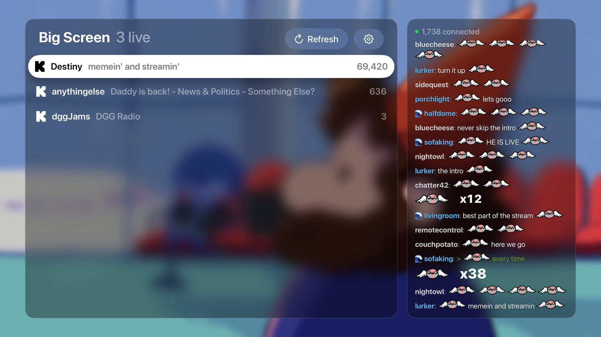
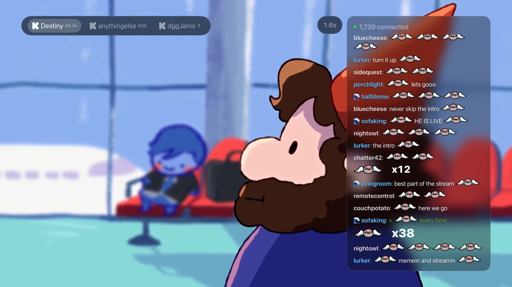

# DGGTV: Destiny.gg on Apple TV

A native tvOS app for [destiny.gg](https://www.destiny.gg). Browse the Big Screen embeds, watch streams, and follow chat from the couch.

## Features

- The same embed list as the Big Screen page, with titles and viewer counts
- Kick and Twitch streams play in the app, previewing behind the list as you browse
- Low delay on Kick: a couple of seconds on a stable stream, adjustable in Settings
- Live chat with animated emotes, combos, flairs and greentext, as an overlay or beside the stream
- Sign in to vote in polls, and hide or show the pinned message
- YouTube embeds open in the YouTube app

DGGTV can't post in chat. The only thing it ever sends is a poll vote you choose.

## How to Install

DGGTV isn't on the App Store, so for now you build it yourself. You'll need a Mac with Xcode and an Apple TV running tvOS 26 or later.

1. Clone this repo and open `DGGTV.xcodeproj`
2. Under Signing & Capabilities, choose your own team
3. Pair your Apple TV in Xcode's Devices and Simulators window
4. Select your Apple TV and press Run

## Signing In

1. On destiny.gg, go to Profile, then Developer, and click **Create Login Key**
2. In the app, open Settings, then **DGG account**
3. Paste the key using the Apple TV keyboard prompt on your iPhone

The key stays in your Apple TV's Keychain and is only sent to destiny.gg chat. Treat it like a password.

## Using the Remote

- **Swipe** left or right to switch embeds, and up or down to scroll chat
- **Click** up or down to pick a poll option or the pin, then **Select** to vote or hide it
- On Home, **click right** to reach chat
- **Play/Pause** opens Settings

## Development

The chat, emote and stream code is in the `DGGKit` package under `Sources`, and the app is in `App/DGGTV`. The Xcode project is generated from `project.yml`, so run `xcodegen` after adding app files.

[NOTES.md](NOTES.md) has the longer story of how everything works and why.
